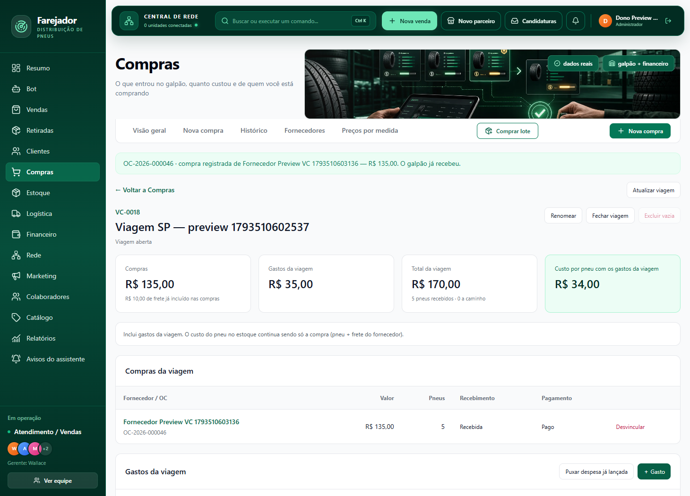
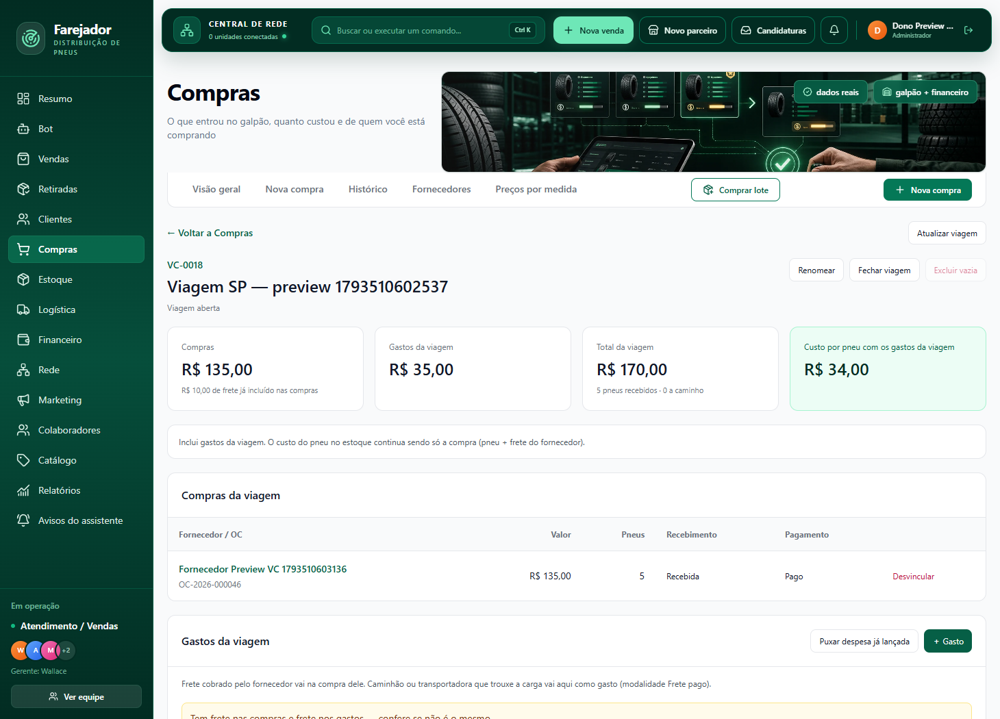
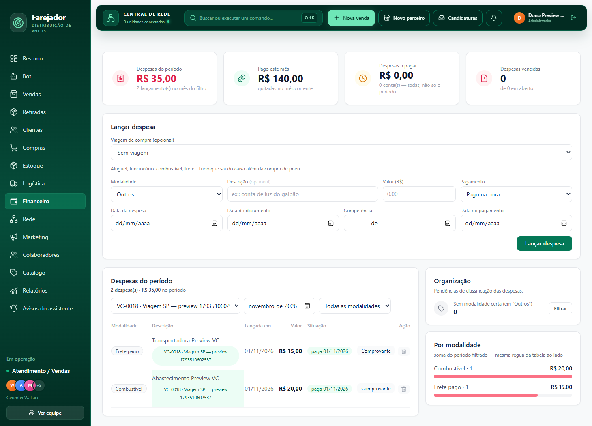
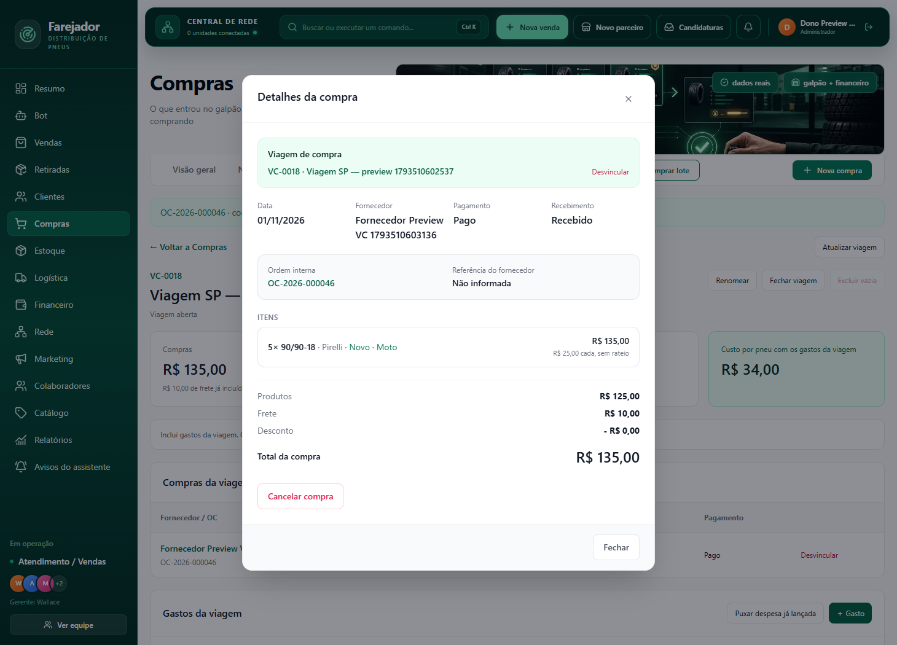

# Viagem de compra — entrega para revisão do Claude (2026-11-01)

## Estado e localização

Implementado e validado localmente. **Não houve push, PR, deploy nem migration no banco de produção.** A etapa atual é a revisão do Claude solicitada pelo Wallace.

- Branch local: `codex/viagem-compra-20261101`.
- Worktree: `C:\Farejador agente\artifacts\matrix-delivery-flow-20261023\release`.
- Base: `9761386801e8242f537c2dcccc12ac9c6eb51b36` (origin/main consultado no início).
- Commit da implementação: `31b65093611b12d5328eed381e479a4f7b8573f5`.
- Plano original preservado sem alteração: [PLANO_VIAGEM_DE_COMPRA_2026-11-01.md](PLANO_VIAGEM_DE_COMPRA_2026-11-01.md).
- SHA256 do plano: `976ed7378a9ce75d74ec1f91efedf3b3e38d9b1f7e709f57be94ed043d37aafa`.

O checkout principal estava com outras alterações. Esta implementação fica no worktree acima; não foi aplicada por cima dessas alterações. Para revisar, entrar nesse worktree e comparar `git diff 97613868..31b65093`. Este documento e as evidências são adicionados em um segundo commit exclusivamente documental, identificável com `git log -2 --oneline`.

## O que foi implementado

A viagem guarda nome, situação e vínculos. Não armazena valores nem lança dinheiro. As três tabelas são `commerce.wholesale_purchase_groups`, `commerce.wholesale_purchase_group_purchases` e `commerce.wholesale_purchase_group_expenses`.

- Compras → Visão geral lista viagens abertas primeiro, com total e custo por pneu. Criar, renomear, fechar, reabrir e excluir vazia usam auditoria e idempotência.
- A tela da viagem mostra compras, gastos por modalidade, recebidos/a caminho, total e custo por pneu. Canceladas e removidas permanecem visíveis, riscadas, fora das somas. Custo provisório e os dois avisos de frete/estoque estão presentes.
- Nova compra, Comprar lote e o formulário existente de Despesas receberam seleção opcional da viagem e “Nova viagem…” inline. Cadastro e vínculo estão na mesma transação; a viagem entra no fingerprint, sem mudar o fingerprint antigo quando não informada.
- Detalhe original da compra mostra o vínculo e permite vincular/desvincular. “+ Gasto” abre o formulário existente no Financeiro, com a viagem preenchida. Despesa existente pode ser puxada. Financeiro → Despesas mostra chip e filtro por viagem.
- Nenhuma compra ou despesa entra em duas viagens; uma OC não se divide. Fechada impede vincular/desvincular. Só viagem vazia é excluída.
- Gastos pertencentes a combustível de rota, comprovante da rota, combustível sem nota aprovado, folha e comissão operacional são recusados. A migration também protege o caminho inverso e mudança de OC, sem atualizar valores ou fontes.
- Escrita só para dono; metadados de viagem acessíveis aos módulos Compras/Financeiro. Campos de pagamento respeitam `can_view_payments`. RLS e nenhum grant ao parceiro nas três tabelas.

Fontes dos números: `wholesale_purchases.total_amount`, `freight_amount`, `wholesale_purchase_lines` e `matriz_expenses.amount`. Frete do fornecedor já está dentro da compra, não é somado de novo. Despesas continuam entrando pelos serviços originais, com seus lançamentos originais. **Vincular/desvincular só grava a etiqueta e a auditoria.** Não há rateio no estoque, pago/pendente da viagem, mudança em parcelas/caixa/lucro, fluxo mobile ou IA novo.

## Migration e publicação

O próximo número livre real era **0280**, não o 0273 antigo citado no plano. Arquivo: [0280_wholesale_purchase_groups.sql](../db/migrations/0280_wholesale_purchase_groups.sql), com checksum no manifest.

Aplicação e provas realizadas somente no PostgreSQL local isolado `farejador_viagem_20261101`, a partir do esquema já existente até 0279. As provas usam `FAREJADOR_ENV=test` e BEGIN/ROLLBACK. O preview grava somente dados fictícios nesse mesmo banco local. Nenhuma conexão de produção foi usada para escrever.

**Antes de qualquer push:** revisão do Claude, aplicação/registro da 0280 nos ambientes oficiais test e prod e verificações pós-migration, conforme o plano. Produção continua pendente. O projeto operacional atual é `beisgivepyfhgcujsqan`; não usar a referência antiga do CLAUDE.md nem os arquivos antigos de ambiente inadvertidamente. Não há variável de ambiente nova.

## Provas executadas

| Verificação | Resultado |
| --- | --- |
| 15 provas de integração, execução 1 | 15/15, exit 0, ROLLBACK preservou o banco |
| 15 provas de integração, execução 2 | 15/15, exit 0, ROLLBACK preservou o banco |
| npm test | 563 arquivos / 3.727 testes passaram, exit 0 |
| npm run typecheck | passou |
| npm run checar-tamanho | passou; módulos novos abaixo de 300 linhas |
| node scripts/prova-paridade-matriz.cjs | 3.122 propriedades, baseline regravado deliberadamente |
| npx tsx scripts/prova-rotas-matriz.ts | 583 rotas, baseline regravado deliberadamente |
| npm run check:migrations | 281 migrations, última 0280; gap 0071 já documentado |
| git diff --check | passou após remover uma linha em branco no fim de arquivo novo |
| Preview real por clique | 6 etapas passaram e conferência de filtro/chips passou |

[Saída integral das 15 provas — execução 1](evidencias/viagem-compra-2026-11-01/proof-run-1.log) · [execução 2](evidencias/viagem-compra-2026-11-01/proof-run-2.log) · [resumo das verificações](evidencias/viagem-compra-2026-11-01/verificacoes.txt).

A prova de imutabilidade calcula hashes SHA256 de todas as linhas, incluindo todas as colunas e timestamps, das tabelas `finance.matriz_ledger_*`, estoque/movimentos, lotes/movimentos, compras/itens e despesas. Ela cria antes estoque físico e lote recebidos pelos serviços reais, vincula e desvincula, e exige hashes idênticos. A prova cobre os cinco donos de despesas por seus fluxos reais, sem desativar triggers. Também verifica rollback do cadastro de compra e despesa quando o vínculo falha, os fingerprints dos dois cadastros e as quatro FKs compostas de environment.

Os testes unitários novos cobrem arredondamento/zero/provisório, frete, cancelamento/remoção, permissões dos módulos, campos de pagamento e guardas das rotas. Na validação, uma regressão intermediária no mock financeiro foi eliminada movendo a decoração dos chips para a resposta HTTP, fora da consulta financeira principal. O teste antigo de Compras foi atualizado apenas na referência do asset cuja versão mudou. Suíte completa final verde.

Para repetir a prova no ambiente local desta máquina:

```powershell
Set-Location 'C:\Farejador agente\artifacts\matrix-delivery-flow-20261023\release'
npx tsx --env-file='C:\Farejador agente\.codex-tmp\viagem-compra-20261101\proof.env' scripts/prova-viagem-compra-test.ts
```

O arquivo de ambiente é privado, ignorado e não faz parte dos commits. Não usar banco de produção para executar a prova. CI remoto não executado, pois não houve push.

## O que vi no preview

Preview final mantido em [http://127.0.0.1:4290/admin/painel](http://127.0.0.1:4290/admin/painel). Existe também a primeira instância local na porta 4289; nenhum recurso anterior do usuário foi encerrado.

Fluxo percorrido por cliques, com login local de dono e formulários reais:

1. Criar viagem pelo diálogo.
2. Nova compra: 5 pneus × R$25 + R$10 de frete, selecionando a viagem → **R$135** na compra original.
3. “+ Gasto”: abriu o mesmo formulário de Despesas do Financeiro, com viagem preenchida; lançar combustível **R$20**.
4. Lançar **R$15** de Frete pago sem viagem e puxar essa despesa existente para a viagem.
5. Conferir fontes e tela: **Compras R$135 + Gastos R$35 = Total R$170 / 5 pneus = R$34 por pneu**; frete incluído R$10 apenas informativo; alerta de frete nos dois lugares visível.
6. Fechar/reabrir: ações de vínculo desapareceram e voltaram; detalhe original da compra mostrou chip.

Uma verificação adicional, só de leitura, clicou no gasto: abriu Financeiro com filtro da viagem e exatamente dois chips nas despesas vinculadas. Viagem final fictícia **VC-0018**, compra **OC-2026-000046**. Os identificadores crescem durante ensaios; não são registros de produção.

### Limitação existente identificada

O console do painel já apresenta erro no gráfico SVG de **Compras → Preços por medida**: `importNode`, `tick`, `series`, `point` e `label`. Reproduzi os mesmos erros servindo os arquivos originais de `origin/main` sem o front novo de viagens, no mesmo banco local. O fluxo novo passou; **não é um preview com console limpo**. Não alterei esse gráfico antigo nesta entrega. [Resultado estruturado e comparação](evidencias/viagem-compra-2026-11-01/preview-result.json).

### Prints reais









## Pontos principais para a revisão

Revisar primeiro as travas da migration 0280, depois `purchase-group-links.ts`, `queries-purchase-groups-write.ts`, fontes do resumo e os dois cadastros originais. Confirmar que os novos gatilhos somente validam vínculos e não mudam fontes. Verificar permissões, ausência de rateio/estado financeiro próprio, equivalência dos números e o reuso do formulário de Despesas.

**Nenhum push autorizado nesta etapa; aguardando a revisão do Claude.**
